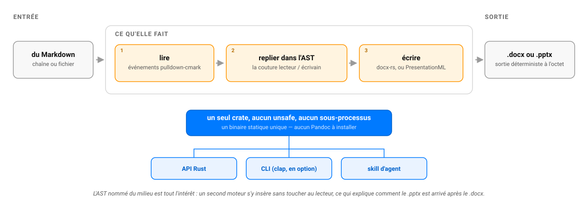

# md2star-rs

[🇫🇷 LISEZMOI](LISEZMOI.md) · [🇬🇧 README](README.md)

[](https://crates.io/crates/md2star-rs)

**Un convertisseur Markdown → DOCX & PPTX 100 % Rust. Sans Pandoc, sans sous-processus, sans
dépendance d'exécution — des binaires statiques qui tournent sur tous les OS et appareils.**

Par [Warith HARCHAOUI](https://linkedin.com/in/warith-harchaoui)

`md2star-rs` est un spin-off du paquet Python [`md2star`](https://github.com/warith-harchaoui/md2star).
L'original est une fine surcouche (excellente) au-dessus de **Pandoc** ; celui-ci vise le
même but — du Markdown en entrée, un `.docx` fidèle en sortie — mais entièrement en Rust :

```text
Markdown ──▶ lecteur (pulldown-cmark → AST) ──▶ écrivain (AST → docx-rs) ──▶ .docx
```

## Pourquoi un spin-off Rust ?

`md2star` est fin *parce que Pandoc est épais* : les fonctionnalités vivent dans Pandoc ;
Pandoc est un binaire Haskell de ~100 Mo qu'il faut installer. C'est acceptable sur un poste
de travail ou en CI, mais cela exclut les téléphones, les machines verrouillées et le WASM.
`md2star-rs` échange l'étendue de Pandoc contre un **binaire unique autonome** et la
maîtrise totale de l'OOXML produit — d'où l'absence de la chirurgie `styles.xml`
(`postprocess.py`) de l'original.

## Comment ça marche



## Installation

```bash
# Depuis crates.io (nécessite Rust — https://rustup.rs)
cargo install md2star-rs
# ou depuis un clone local
cargo install --path .
# ou les binaires release
cargo build --release   # → target/release/md2star-rs, md2docx, md2pptx
```

Nécessite Rust 1.88 ou plus récent. Rien d'autre : ni Pandoc, ni bibliothèque système.

Comme dépendance de bibliothèque :

```toml
[dependencies]
md2star-rs = "0.4"
```

La fonctionnalité `cli`, active par défaut, construit les trois binaires et tire `clap`. Une
bibliothèque qui ne les appelle jamais peut s'en passer :

```toml
md2star-rs = { version = "0.4", default-features = false }
```

Voir [`scripts/brew.sh`](scripts/brew.sh) pour une installation de Rust via Homebrew
(macOS/Linux).

## Utilisation

```bash
md2docx rapport.md                             # → rapport.docx (à côté de l'entrée)
md2docx rapport.md -o out/final.docx
md2docx rapport.md --reference-doc modele.docx # style le résultat comme modele.docx
md2pptx expose.md                              # → expose.pptx (chaque titre `#` = une diapo)
```

`--reference-doc` hérite des styles, du thème, des polices et de la mise en page du modèle ;
il rend les titres/citations via ses styles nommés (`Heading1`…`Heading6`, `Quote`) — comme
l'option homonyme de Pandoc.

En bibliothèque :

```rust
use std::path::Path;
md2star_rs::markdown_to_docx_file("# Titre\n\nBonjour.", Path::new("out.docx")).unwrap();
let octets = md2star_rs::markdown_to_docx_bytes("Bonjour **le monde**").unwrap();

// Styler la sortie d'après un modèle lu sur disque.
let modele = std::fs::read("modele.docx").unwrap();
let stylise = md2star_rs::markdown_to_docx_bytes_with_reference("# Titre", &modele).unwrap();

// Ou produire une présentation PowerPoint — chaque titre `#` devient une diapo.
let deck = md2star_rs::markdown_to_pptx_bytes("# Diapo 1\n\n- point\n- point").unwrap();
```

Plus d'exemples dans [`EXAMPLES.md`](EXAMPLES.md).

## Ce qui marche aujourd'hui (v0.4)

**Deux backends** sur un même lecteur/AST : `md2docx` (DOCX) et `md2pptx` (PPTX). Le tableau
ci-dessous détaille la surface DOCX ; `md2pptx` fait de chaque titre `#` une diapo puis aplatit
le corps en puces (ordonnées → numérotées, imbriquées → sous-puces, citations/code/tableaux →
lignes de puces).

| Markdown | Sortie DOCX |
|---|---|
| Titres `#`–`######` | Paragraphes gras à taille graduée, ou les styles `Heading1`…`Heading6` du modèle sous `--reference-doc` |
| Modèle de référence | **`--reference-doc modele.docx`** : hérite styles/thème/polices/mise en page ; titres et citations via les styles nommés |
| Paragraphes, `**gras**`, `_italique_`, `` `code` `` | Segments au formatage correspondant |
| Listes à puces et ordonnées | **Numérotation Word native** (`numbering.xml` + `numPr`) ; les puces sont de vraies puces, chaque liste ordonnée repart de son propre premier numéro (`5.` ouvre à 5) ; l'imbrication donne des niveaux de retrait |
| Tableaux GFM | Vrais tableaux Word (`<w:tbl>`) |
| Blocs de code délimités | Police à chasse fixe, lignes préservées |
| Citations | Rendues en ligne (récursivement) |
| Notes `[^x]` | **Vraies notes de bas de page Word** (`word/footnotes.xml`) |
| Liens / images | Texte visible / texte alternatif en remplacement |

**Idempotent par construction :** le même Markdown produit une sortie identique octet pour
octet à chaque exécution, `.docx` *comme* `.pptx`, même sur des fils d'exécution concurrents.
Les identifiants DOCX viennent de compteurs propres à chaque document (jamais d'un compteur
global au processus) ; la sortie PPTX est réempaquetée avec un horodatage fixe pour que l'heure
murale estampillée par `ppt-rs` ne s'y glisse pas.

## Périmètre et compromis face à Pandoc

Première version ciblée, pas un remplaçant de Pandoc. **Pas encore** ici, chacun étant une
suite propre et non une refonte : bibliographie/citations (pas de moteur CSL Rust stable),
math → OMML, hyperliens, images intégrées. Le backend PPTX est volontairement « texte
d'abord » : il aplatit le formatage inline et n'intègre pas encore d'images. Pour tout cela,
gardez [`md2star`](https://github.com/warith-harchaoui/md2star) comme voie « fidélité maximale ».

## Skill d'agent

`skills/md2star-rs/` empaquette cette crate en **Claude Skill** et en **skill
OpenCode**, pour qu'un agent la découvre et convertisse des documents pour le
compte de l'utilisateur. L'installation pour les deux hôtes est dans
[`skills/README.md`](skills/README.md).

Son catalogue de déclencheurs est imposé, pas décoratif :
[`TRIGGERS.md`](TRIGGERS.md) est le catalogue destiné aux humains,
`references/triggers.md` en est le miroir destiné à l'agent ;
`tests/skill.rs` fait échouer `cargo test` — donc le hook de pré-push — si les
deux divergent, si la `description` du skill dépasse le plafond publié de 1024
caractères, si son `name` cesse de correspondre à son dossier ou s'il pointe
vers une référence qui n'existe plus.

Le catalogue est aussi l'endroit où l'écart de fidélité avec le `md2star`
Python est énoncé, parce que c'est le seul choix ici qui échoue en silence :
citations, math, images embarquées et PDF sont absents par décision de
périmètre, or un document auquel ils manquent a l'air terminé.

## Trois binaires : lequel choisir

`cargo install md2star-rs` installe **`md2star-rs`**, `md2docx` et `md2pptx`.

`md2docx` et `md2pptx` portent **les noms mêmes qu'installe le `md2star`
Python** : avec les deux sur une machine, c'est l'ordre du `PATH` qui tranche,
sans que rien ne dise lequel a tourné. Ils sont conservés parce que les
renommer casserait toutes les installations existantes.

```bash
md2star-rs docx rapport.md -o rapport.docx
md2star-rs pptx expose.md  -o expose.pptx
```

`md2star-rs docx` et `md2star-rs pptx` ne peuvent entrer en collision avec
rien. Ils délèguent aux mêmes appels de bibliothèque : la sortie est
identique octet pour octet. À utiliser dans les scripts, les Dockerfile et la
CI, partout où savoir avec certitude quelle implémentation a tourné compte plus
que la brièveté. Garder `md2docx` pour l'usage interactif si vous préférez ;
lancer `which md2docx` quand la sortie surprend.

## Développement

```bash
cargo test                                   # unitaires + intégration + doc-tests
cargo fmt --check                            # garde-fou de formatage
cargo clippy --all-targets -- -D warnings    # garde-fou de lint (avertissements = erreurs)
```

La CI lance les trois sous Linux, plus le contrôle de résolution à neuf ci-dessous, dans un
seul job, délibérément. Les tests lourds sur plusieurs plateformes reviennent au garde-fou
local de pré-push (`scripts/install-hooks.sh`) : la CI confirme ce qui est déjà passé, elle ne
découvre rien.

## Vérifications avant de pousser

```bash
scripts/install-hooks.sh   # une fois par clone : installe le garde-fou pre-push ci-dessous
cargo fmt --all --check
cargo clippy --all-targets -- -D warnings
cargo test --all
scripts/check-fresh-resolve.sh   # compile sans Cargo.lock, comme un consommateur en aval
```

Le dernier existe parce que les trois autres, comme la CI, compilent tous contre le
`Cargo.lock` commité — que personne n'utilise en aval du crate publié. Un intervalle de
dépendance devenu mauvais reste vert ici tout en cassant chaque `cargo add` / `cargo
install` neuf et `cargo publish --dry-run` ne le voit pas non plus (il vérifie avec le
même lock). La CI lance ce contrôle une fois, sous Linux.

## Licence

Apache-2.0 — voir [`LICENSE`](LICENSE).
