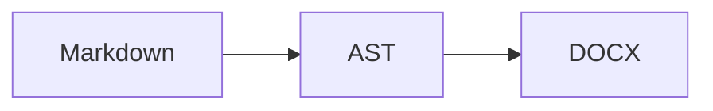

# Headings and attributes {#intro .unnumbered}

Plain text with **bold**, *italic*, ***both***, ~~struck~~, `code`, H~2~O and 2^10^.
A soft break follows,
and a hard break follows  
right here.

## A heading with a layout hint {.bignumber layout="Big Number"}

**×18**

## Links and images

A [link](https://deraison.ai "home"){.external}, an autolink <https://example.org>,
an inline image {width=1in} in text,
and a data URI .

{#fig:photo width=50%}


## Notes

A footnote[^first], another[^long] and an inline note^[Written *in place*.].

[^first]: The first footnote.

[^long]: A longer note.

    With a second paragraph.

## Math

Inline $E = mc^2$, display:

$$
\int_{-\infty}^{\infty} e^{-x^2}\,dx = \sqrt{\pi}
$$

and math in a code span: `$\frac{a}{b}$`, mixed: `learning_rate $\in (0, 1]$`.

## Citations

As argued [@pearl2009, p. 3; see also @pearl2000], and @pearl2009 [chap. 2] agrees;
the year alone [-@pearl2000]. An e-mail like someone@example.org is not a citation.

## Tables

| Left | Center | Right | Default |
|:-----|:------:|------:|---------|
| a    | b      | 1.5   | x       |
| *c*  | `d`    | 22    | $y^2$   |

Table: Aligned columns and a caption {#tbl:aligned}

## Lists

- [x] a done task
- [ ] an open task
- a plain bullet
  1. nested ordered
  2. second

3. starts at three
4. four

> A quotation,
> on two lines.
>
> > And a nested one.

---

# Slides {.section}

::: notes
Speaker notes for the section slide, with **bold**.
:::

---

## Two columns

:::: columns
::: {.column width="40%"}
Left column.
:::

::: column
Right column.
:::
::::

## A statement {.statement}

One short sentence, set large.

## Code and diagrams

```python {#listing .numberLines}
def f(x):
    # a comment, not a heading
    return x ** 2
```



::: warning
A custom div with a class.
:::

<!-- an HTML comment the writers ignore -->

***

# Closing {.closing}
